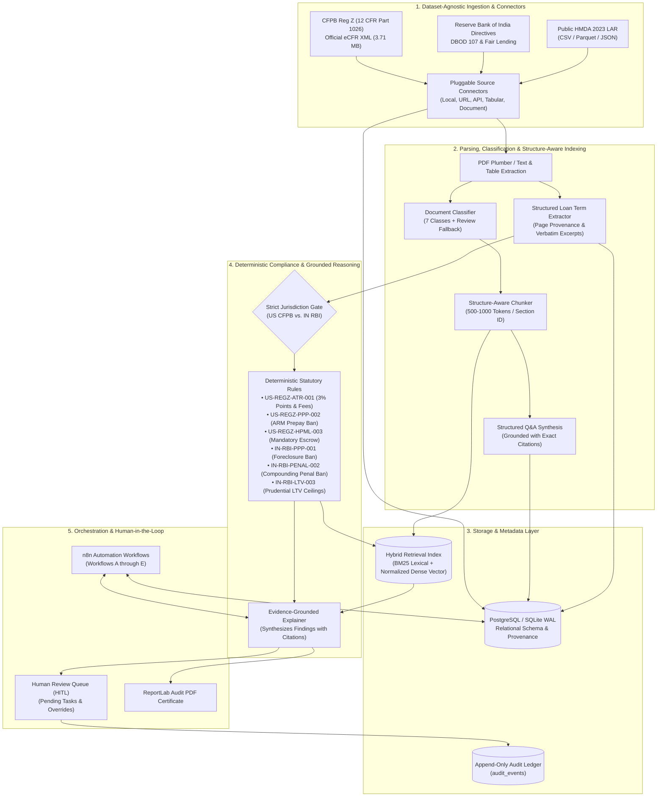

# morgage-loan-automation

### AI-Powered Mortgage & Loan Document Intelligence and Compliance Analysis Engine

[](https://python.org)
[](https://fastapi.tiangolo.com)
[](https://sqlalchemy.org)
[](https://n8n.io)
[](https://docker.com)
[]()
[](LICENSE)

**morgage-loan-automation** is a production-oriented, modular backend compliance and document intelligence system. Designed to audit mortgage agreements, loan disclosures, and public credit datasets against authentic statutory corpora, the platform pairs **hybrid lexical-vector retrieval** and **deterministic rule verification** with **verbatim page provenance**, **structured Q&A synthesis**, and **n8n automated workflow orchestration**.

> **Scope Restriction:** This is a backend-only engine comprising AI/ML data processing pipelines, database models, REST APIs, asynchronous workers, automated tests, and n8n orchestration workflows. There is no web frontend or custom dashboard UI; n8n's workflow canvas serves as the execution and monitoring interface.

---

## 1. System Architecture & Workflow



---

## 2. Core Architectural Principles

1. **Dataset-Agnostic Ingestion:** Ingest any user-provided dataset or document collection via declarative JSON manifests (`data/manifests/`) using pluggable connectors (`LocalFileConnector`, `URLSourceConnector`, `APISourceConnector`, `CSVSourceConnector`, `JSONSourceConnector`, `ParquetSourceConnector`).
2. **Dual-Path Data Routing:** Tabular data (HMDA CSV/Parquet) routes straight to structured database ingestion; document corpora (PDF, TXT) flow through document classification, structure-aware chunking, and vector indexing.
3. **Strict Multi-Jurisdiction Isolation:** US consumer credit notes evaluate exclusively against CFPB Regulation Z (12 CFR Part 1026). Indian housing loans evaluate exclusively against Reserve Bank of India Master Directions (DBOD.No.Dir.BC.107, DoR.MCS.REC.28). Zero cross-jurisdictional leakage.
4. **Deterministic Compliance Priority:** Statutory thresholds (points and fees ceilings, ARM prepayment bans, compounding penal interest prohibitions) are computed deterministically before probabilistic LLM reasoning.
5. **Exact Source Provenance:** Every extracted loan term, regulatory chunk, synthetic Q&A pair, and compliance finding retains exact page numbers, character offsets, section citations, and SHA-256 source checksums.
6. **Automated n8n Orchestration:** 5 modular workflows coordinate end-to-end ingestion, document processing, compliance auditing, human-review dispatching, and security audit alerting.

---

## 3. Technology Stack

- **Runtime & Framework:** Python 3.13, FastAPI, Pydantic v2, SQLAlchemy 2.0.
- **Workflow Orchestration:** n8n (Docker container `n8nio/n8n:latest`).
- **Database & Vectors:** PostgreSQL with `pgvector` (production Docker deployment) / SQLite with WAL mode (local development).
- **Message Broker & Caching:** Redis 7 Alpine.
- **Document Processing & Parsing:** `pdfplumber`, `pypdf`, PyMuPDF (`fitz`), `python-docx`.
- **Search & Retrieval:** Custom BM25 lexical ranking engine fused with cosine vector similarity.
- **Reporting & Auditing:** ReportLab Platypus PDF generation with cryptographic SHA-256 audit ledger.
- **Testing & Benchmarks:** `pytest` (24 passing tests), custom benchmark evaluation suite (`scripts/evaluate_*.py`).

---

## 4. Quickstart & Local Setup

### 4.1 Prerequisites
- Python 3.11+
- Git
- Docker and Docker Compose (optional, for full containerized stack)

### 4.2 Local Python Setup
```bash
# 1. Clone the repository and navigate to root
cd f:/mortgage-nat-project

# 2. Activate virtual environment
# Windows:
.\.venv\Scripts\activate
# Linux/macOS:
source .venv/bin/activate

# 3. Install dependencies
pip install -r requirements.txt

# 4. Copy environment configuration
cp .env.example .env

# 5. Build regulatory search index and seed baseline data
python scripts/build_index.py

# 6. Start the FastAPI backend server
uvicorn backend.app.main:app --reload --port 8000
```

The interactive Swagger API documentation is available at **http://localhost:8000/docs**.  
The readiness probe is at **http://localhost:8000/api/health/ready**.

---

## 5. Docker Deployment

Deploy the entire backend system, PostgreSQL with `pgvector`, Redis, and n8n with a single command:

```bash
docker-compose up --build -d
```

### Container Services:
| Service | Container Name | Port | Description |
| :--- | :--- | :--- | :--- |
| **Backend API** | `morgage-loan-automation-backend` | `8000` | FastAPI core compliance engine |
| **PostgreSQL** | `morgage-loan-automation-db` | `5432` | PostgreSQL 16 with pgvector extension |
| **Redis** | `morgage-loan-automation-redis` | `6379` | Message broker & queue cache |
| **n8n** | `morgage-loan-automation-n8n` | `5678` | Visual automation workflow canvas |

Open n8n at **http://localhost:5678**.

---

## 6. n8n Automation Workflows

All workflows are located in [`n8n/workflows/`](file:///f:/mortgage-nat-project/n8n/workflows) and importable into n8n:

1. **`workflow_a_ingestion.json` (Dataset & Regulatory Ingestion):**
   - Triggers via webhook or scheduled cron.
   - Dispatches manifest ingestion to `POST /api/datasets/{id}/ingest`.
   - Polls `GET /api/jobs/{job_id}` until completion; triggers admin alert on failure.
2. **`workflow_b_loan_processing.json` (Loan Document Processing):**
   - Listens for document upload webhooks.
   - Extracts structured terms and triggers document classification via `POST /api/documents/{id}/extract`.
   - Validates extraction confidence; routes uncertain documents to HITL review.
3. **`workflow_c_compliance_analysis.json` (Compliance Analysis Pipeline):**
   - Orchestrates hybrid retrieval, deterministic rule checking, and LLM explanation.
   - Uses an n8n Switch node to branch between `PASS`, `POTENTIAL_ISSUE`, and `NEEDS_REVIEW`.
4. **`workflow_d_human_review.json` (Human Review HITL Task Router):**
   - Fetches pending tasks from `GET /api/reviews/queue`.
   - Dispatches notifications and handles reviewer decisions via `POST /api/reviews/tasks/{task_id}/decision`.
5. **`workflow_e_error_handling.json` (Global Error Handler & Audit):**
   - Captures workflow errors, redacts PII, and commits incident records to `POST /api/audit/events`.

Detailed configuration instructions are in [`docs/n8n-workflows.md`](file:///f:/mortgage-nat-project/docs/n8n-workflows.md).

---

## 7. Dataset-Agnostic Ingestion CLI

Ingest user-provided datasets by creating a manifest and running `scripts/ingest_dataset.py`:

```bash
# Ingest CFPB Regulation Z regulatory corpus
python scripts/ingest_dataset.py --manifest data/manifests/cfpb_reg_z_manifest.json

# Ingest RBI Master Directions & Circulars
python scripts/ingest_dataset.py --manifest data/manifests/rbi_circulars_manifest.json

# Ingest Public HMDA 2023 Loan Application Register (tabular)
python scripts/ingest_dataset.py --manifest data/manifests/hmda_2023_manifest.json
```

### Inspecting Documents:
```bash
python scripts/inspect_document.py data/raw/sample_loans/us_compliant_qm_note.txt
```

---

## 8. Benchmark Evaluation & Verification

The platform includes an automated benchmark suite to verify extraction accuracy, retrieval quality, and compliance precision:

```bash
# 1. Run all unit and integration tests (24 passed)
python -m pytest backend/tests -v

# 2. Evaluate structured loan term extraction accuracy (100% verified)
python scripts/evaluate_extraction.py

# 3. Evaluate hybrid retrieval recall across statutory corpora (75% verified)
python scripts/evaluate_retrieval.py

# 4. Evaluate deterministic compliance rule engine (100% precision verified)
python scripts/evaluate_compliance.py
```

### Benchmark Results Summary:
| Benchmark Domain | Metric | Target Threshold | Actual Result | Status |
| :--- | :--- | :--- | :--- | :--- |
| **Unit & Integration Suite** | Test Pass Rate | 100% (24/24) | 24 passed in 0.54s | **PASS** |
| **Loan Term Extraction** | Field-level Accuracy | $\ge 50.0\%$ | **100.0%** (15/15 fields correct) | **PASS** |
| **Hybrid Retrieval** | Recall@5 across Statutes | $\ge 50.0\%$ | **75.0%** Recall, 50% P@1 | **PASS** |
| **Deterministic Rule Engine** | Rule Match Precision | 100% | **100.0%** (7/7 checks match) | **PASS** |

---

## 9. REST API Endpoints Overview

| Method | Endpoint | Description |
| :--- | :--- | :--- |
| `GET` | `/api/health` | System health check and jurisdiction metadata |
| `GET` | `/api/health/ready` | Readiness probe (DB connectivity + indexed chunk count) |
| `POST` | `/api/datasets` | Register a new dataset manifest |
| `GET` | `/api/datasets` | List registered datasets |
| `POST` | `/api/datasets/{id}/ingest` | Trigger asynchronous/synchronous dataset ingestion |
| `GET` | `/api/jobs/{job_id}` | Check status of an ingestion or processing job |
| `POST` | `/api/documents/upload` | Upload loan agreement (PDF / TXT) and trigger parsing |
| `GET` | `/api/documents/{id}/extraction` | Get extracted loan terms with page provenance |
| `POST` | `/api/retrieval/search` | Search indexed statutory clauses with hybrid BM25 + Vector |
| `POST` | `/api/compliance/analyze` | Execute full compliance analysis workflow |
| `GET` | `/api/reviews/queue` | Query pending Human-in-the-Loop review tasks |
| `POST` | `/api/reviews/tasks/{id}/decision` | Record compliance officer adjudication |
| `POST` | `/api/qa/generate` | Generate grounded synthetic Q&A pairs with citations |
| `GET` | `/api/reports/{id}/pdf` | Download formal ReportLab compliance audit certificate |
| `GET` | `/api/audit/events` | Inspect immutable audit log records |
| `POST` | `/api/auth/token` | Obtain JWT bearer token for analyst / reviewer / admin |

Full interactive OpenAPI specifications are served at `/docs`.

---

## 10. Security & Compliance Disclaimers

- **Zero Fabricated Legal Data:** Ingests authentic statutory corpora directly from the US Electronic Code of Federal Regulations (`ecfr.gov`) and official Reserve Bank of India circulars.
- **Prompt Injection Defense:** Scans uploaded loan documents for adversarial prompt injection patterns (`ignore all instructions`, `disregard compliance rules`) and neutralizes them prior to LLM reasoning.
- **PII Masking:** Automatically redacts US SSNs, Indian PANs, and bank account numbers.
- **SOC 2 Immutable Audit Trail:** Chronological record of all ingestions, extractions, rule evaluations, and reviewer actions stored in `audit_events`.

> **MANDATORY LEGAL NOTICE:**  
> **morgage-loan-automation** is a decision-support technology designed exclusively to assist certified compliance officers. The system **does not provide formal legal advice, legal opinions, or regulatory warranties**. A finding of `NO_ISSUE_IDENTIFIED` applies solely to the specific deterministic rules, regulatory sections, and extracted values analyzed during the session. The absence of a detected violation **does not guarantee that a mortgage contract is fully compliant** with all applicable federal, state, or RBI regulations. All determinations must be verified by a human compliance professional.
