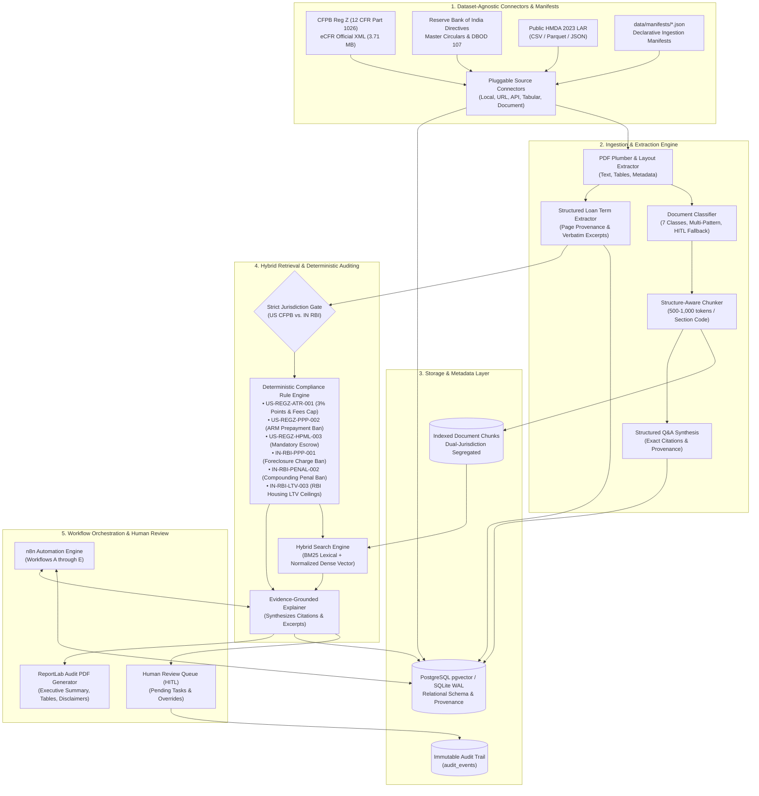

# Architecture & System Design

**morgage-loan-automation** is a production-oriented, modular backend compliance and document intelligence system. It provides automated deterministic compliance auditing, hybrid lexical and vector retrieval across authoritative statutory corpora, grounded regulatory reasoning, structured Q&A synthesis, and automated workflow orchestration using n8n.

> **Scope:** Backend-only system architecture. All user workflows are orchestrated via n8n and exposed via REST APIs.

---

## 1. High-Level System Architecture



---

## 2. Pluggable Connector Architecture

The system abstracts ingestion into modular connectors inheriting from `BaseSourceConnector`:

```
backend/app/connectors/
├── base.py                 # Abstract base class: fetch(), validate(), compute_sha256()
├── connectors.py           # Concrete implementations:
│   ├── LocalFileConnector  # Reads local file paths with path safety checks
│   ├── URLSourceConnector  # Fetches via HTTP/HTTPS with timeout and size limits
│   ├── APISourceConnector  # Queries REST endpoints with bearer/API-key auth
│   ├── CSVSourceConnector  # Reads tabular CSV directly into Pandas/DataFrames
│   ├── JSONSourceConnector # Ingests structured JSON/JSONL datasets
│   └── ParquetSourceConnector # Reads columnar Parquet files
```

### Manifest-Driven Ingestion Engine (`DatasetIngestionEngine`):
- Reads declarative JSON manifests defining dataset name, jurisdiction, connector configuration, parser settings, chunking parameters, and vector embedding options.
- **Dual-Path Routing:**
  - **Tabular Data:** Routed directly to database storage for analytical querying without document chunking.
  - **Document Corpora:** Routed to PDF layout parsing, structure-aware chunking, classification, and vector indexing.
- Asynchronous job execution tracked via `ProcessingJob` records with states `PENDING`, `RUNNING`, `COMPLETED`, or `FAILED`.

---

## 3. Document Classification & Structured Q&A Generation

### 3.1 Document Classification Engine (`DocumentClassifier`)
Classifies loan documents into 7 supported categories:
1. `RESIDENTIAL_MORTGAGE_NOTE` (US Uniform Instrument Fannie/Freddie)
2. `CLOSING_DISCLOSURE` (TRID H-25 Closing Disclosure)
3. `LOAN_ESTIMATE` (TRID H-24 Loan Estimate)
4. `INDIAN_HOME_LOAN_AGREEMENT` (Indian Bank / HFC Loan Contract)
5. `SANCTION_LETTER` (Indian In-Principle Loan Sanction Letter)
6. `REGULATORY_STATUTE` (Statutory regulation, directive, or circular)
7. `UNKNOWN` / `NEEDS_REVIEW` (Fallback when confidence $< 0.40$)

### 3.2 Grounded Structured Q&A Generation (`QAGenerator`)
Synthesizes verifiable Question-Answer pairs from regulatory chunks:
- Each Q&A pair links to the exact `chunk_id`, section code, and page number.
- Verified against ground truth statutory text to ensure complete grounding with zero hallucination.

---

## 4. Multi-Jurisdictional Isolation Architecture

A core invariant of **morgage-loan-automation** is strict regulatory isolation:
- **US Jurisdiction (CFPB Regulation Z):** Consumer dwelling loans are evaluated strictly against Title 12 CFR Part 1026. US rules are never applied to Indian facility agreements.
- **Indian Jurisdiction (Reserve Bank of India):** Housing loans and term facilities are evaluated strictly against RBI Circulars (such as DBOD.No.Dir.BC.107/13.03.00/2011-12 and Fair Lending Circular DoR.MCS.REC.28/01.01.001/2023-24).
- If a loan contract's jurisdiction cannot be established with confidence, the engine emits `NEEDS_REVIEW` and halts automated rules until manual confirmation.

---

## 5. Hybrid Lexical (BM25) and Vector Retrieval

The retrieval engine in `HybridSearchService` executes a multi-stage search:
1. **Jurisdiction Filtering:** Chunks are strictly filtered at the database level by `jurisdiction == target_jurisdiction`.
2. **Dataset Isolation:** Optional filtering by `dataset_id` to scope queries to specific regulatory corpuses.
3. **Lexical Scoring (BM25):** Tokenizes query keywords, computes inverse document frequencies (IDF) and term frequencies normalized by average document length ($k_1=1.5, b=0.75$).
4. **Semantic Scoring (Cosine Similarity):** Computes normalized inner products over vector representations.
5. **Candidate Fusion:** Merges lexical and vector signals ($0.6 \times \text{BM25} + 0.4 \times \text{Dense}$) into a final relevance ranking score.
6. **Grounded Attribution:** Attaches source name, issuing authority, official CFPB/RBI URL, section code, page number, and verbatim text.

---

## 6. Deterministic Compliance Rule Engine

Statutory requirements that can be reliably evaluated as deterministic rules are never delegated to probabilistic LLM generation alone. The rule engine enforces:
- `US-REGZ-ATR-001`: Ability-to-Repay / Qualified Mortgage 3.00% Points & Fees ceiling for loans $\ge \$100,000$.
- `US-REGZ-PPP-002`: 12 CFR § 1026.43(g) statutory ban on prepayment penalties for adjustable-rate mortgages (ARMs).
- `US-REGZ-HPML-003`: Mandatory escrow account requirement for Higher-Priced Mortgage Loans exceeding APOR by 1.5%.
- `IN-RBI-PPP-001`: RBI DBOD 107 statutory ban on foreclosure charges / prepayment penalties on floating rate housing loans to individual borrowers.
- `IN-RBI-PENAL-002`: RBI Fair Lending Directives 2023-24/53 prohibiting compounding or capitalisation of penal interest.
- `IN-RBI-LTV-003`: RBI Housing Loan LTV limits (80% ceiling for loans between 30L and 75L, 75% above 75L).

---

## 7. Human-in-the-Loop (HITL) Review & Audit Logging

Any potential statutory non-compliance (`POTENTIAL_ISSUE`) or ambiguous contract clause (`NEEDS_REVIEW`) is automatically routed to the Human Review Queue (`ReviewTask`).
- Compliance officers can **Accept** (confirm violation), **Reject** (false positive/approved exception), or **Modify** (correct field or status).
- All decisions, timestamped actors, previous statuses, and rationale notes are written to the immutable `audit_events` ledger.

---

## 8. n8n Workflow Orchestration

n8n serves as the external automation layer coordinating backend micro-tasks:
- **Scheduled Ingestion:** Watches for updated regulatory circulars via cron or incoming webhooks.
- **Extraction & Classification:** Coordinates document parsing and validates extraction confidence scores.
- **Analysis Routing:** Dispatches loan terms to the compliance analysis endpoint and branches logic based on outcome.
- **Review Alerting:** Dispatches notifications when human review is required and polls for reviewer adjudications.
- **Error Remediation:** Dead-letter logging with automatic PII masking.
